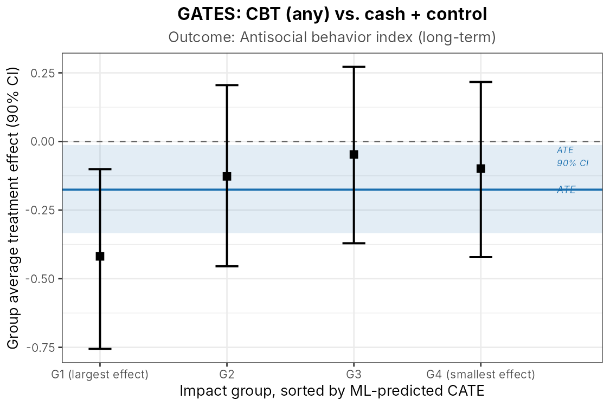
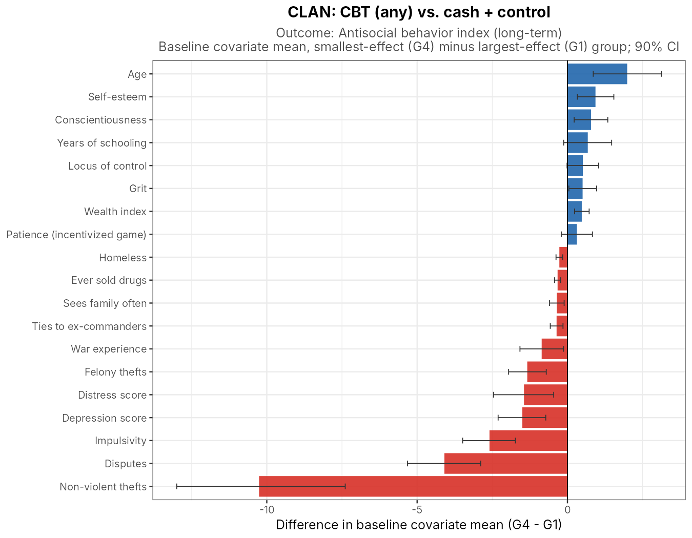

# Who benefits from cognitive behavioral therapy?

**Generic machine learning inference on heterogeneous treatment effects in a crime-reduction RCT (Blattman, Jamison & Sheridan, AER 2017)**

Pedro Ferreira and Jovitah Namutebi · Harvard, ECON 2148 *Causal Inference in Economics* · Spring 2026

[**Read the paper (PDF)**](Writeup/paper_v2.pdf) · [Estimation code](Code/01_run_genericml.R) · [Reporting code](Code/02_extract_results.R) · [Results](Output/)

---

## The question

Blattman, Jamison and Sheridan randomized 999 high-risk men in Monrovia, Liberia, into a 2×2 design crossing eight weeks of cognitive behavioral therapy (CBT) with a $200 cash grant. CBT reduced crime and antisocial behavior, and the effect lasted at least a year when paired with cash. The original paper never asked **who** benefits most, because no heterogeneity analysis had been pre-specified.

That question matters for policy. If baseline characteristics predict who responds, an expensive program can be targeted instead of offered to everyone. We re-analyzed the experiment to test for heterogeneity in CBT's effect and to characterize the men who benefit most.

## Why this approach

With 57 baseline covariates (demographics, mental health, personality, time and risk preferences, criminal history), hand-picking subgroups invites data mining. We instead use the **Generic ML** framework of Chernozhukov, Demirer, Duflo and Fernández-Val (Econometrica, 2025):

1. Split the sample in half. On the auxiliary half, train an ML proxy for the conditional average treatment effect (we use **lasso** and **random forests**).
2. On the held-out half, estimate three low-dimensional, interpretable targets:
   the **Best Linear Predictor** of the CATE on the proxy (its slope, β₂, is a formal test of *H₀: no heterogeneity*),
   **Sorted Group Average Treatment Effects** by quartile of the predicted CATE (GATES), and
   a **Classification Analysis** comparing baseline characteristics of the top and bottom quartiles (CLAN).
3. Repeat the split 100 times and aggregate by medians, with p-values and confidence intervals adjusted for split uncertainty.

The method gives valid inference **without assuming the ML learner is consistent**, which is what makes it usable at N = 999. ML is used here as an input to a causal inference procedure, not as a predictive model whose accuracy is the end goal.

## What we found

| Analysis | Contrast | Outcome | ATE (β₁) | *p* | Heterogeneity (β₂) | *p* |
|---|---|---|---:|---:|---:|---:|
| A1 | CBT only vs. control | Antisocial behavior, short-term | −0.225 | 0.073 | 0.146 | 0.556 |
| A2 | CBT only vs. control | Antisocial behavior, long-term | −0.010 | 0.931 | −0.244 | 0.673 |
| A3 | CBT only vs. control | Thefts, short-term | −0.934 | 0.109 | 0.271 | 0.198 |
| A4 | Any CBT vs. cash + control | Antisocial behavior, short-term | −0.218 | 0.009 | 0.282 | 0.201 |
| **A5** | **Any CBT vs. cash + control** | **Antisocial behavior, long-term** | **−0.176** | **0.034** | **0.557** | **0.060** |
| A6 | Any CBT vs. cash + control | Thefts, short-term | −0.649 | 0.078 | −0.065 | 0.819 |

*Medians over 100 sample splits; 90% confidence intervals and full detail in [`Output/BLP_all.csv`](Output/BLP_all.csv). Antisocial behavior is a standardized index (lower = more prosocial). A4–A6 use the full 2×2 factorial, pooling both CBT arms against both non-CBT arms, which roughly doubles the sample.*

- **The average effects reproduce the published paper.** β₁ matches Blattman et al.'s ITT estimates before we look at heterogeneity.
- **Short-run effects look homogeneous.** None of the short-term analyses rejects *H₀: no heterogeneity*.
- **Long-run effects are not.** In A5, β₂ = 0.557 (*p* = 0.060; 90% CI excludes zero). The quartile with the largest predicted effect sustains a 0.42 s.d. reduction in antisocial behavior a year later, while the other three quartiles are statistically indistinguishable from zero.

<p align="center"></p>

- **Who are the responders?** At baseline, the top-quartile group was the most impulsive, the most criminally active (ten more non-violent thefts in the past two weeks than the bottom quartile), the most psychologically distressed and the most economically precarious. That is the opposite of the "marginal criminal" prior under which CBT should work best for men who are closest to a prosocial life already.

<p align="center"></p>

We read this as suggestive rather than conclusive. Heterogeneity is detected at the 10% level in one of six analyses, and N = 999 is modest for this exercise. But it is the first evidence on targeting for this program, and it points to a program whose lasting impact concentrates among those deepest in crisis.

## How we validated it

- Reproduced the paper's average effects before testing heterogeneity.
- Ran two blocks of analyses (narrow CBT-only contrast; full factorial) across three outcomes, so the heterogeneity result can be seen in context rather than cherry-picked.
- Two learner families (lasso, random forest); `GenericML` picks the best learner per target by its goodness-of-fit criterion, and the choice is recorded in every output file.
- 100 random splits with median aggregation and split-adjusted inference; propensity score fixed at the known randomization probability.
- All reported numbers and figures are generated by `Code/02_extract_results.R` from the saved model objects, so the paper and this README can be regenerated from the repository.

## Repository layout

```
Code/
  01_run_genericml.R      Stage 1: loads the replication data, runs six GenericML analyses,
                          saves one model object per analysis to Output/gml_A*.rds
  02_extract_results.R    Stage 2: turns the .rds objects into every table and figure
Output/
  gml_A1.rds … gml_A6.rds GenericML objects (100 splits each)
  BLP_A*.csv, BLP_all.csv  Best Linear Predictor: ATE and heterogeneity coefficients
  GATES_A*.csv, .png, .pdf Sorted group average treatment effects
  CLAN_A*.csv, .png, .pdf  Classification analysis (baseline means by impact group)
  BLP_table.tex            Table 2 of the paper
  BLP_heterogeneity_summary.png, GATES_combined_comparison.png
Writeup/
  paper_v2.pdf, paper_v2.tex, refs.bib
```

## Reproducing

Stage 2 runs from the saved model objects in this repository and needs no data:

```sh
Rscript Code/02_extract_results.R        # ~1 minute; rewrites Output/
```

Stage 1 re-estimates everything from the raw data:

1. Download the replication package for Blattman, Jamison & Sheridan (2017) from the [AER / openICPSR archive](https://www.openicpsr.org/openicpsr/project/113056/version/V1/view) and place `STYL_Final.dta` under `Data/BLATTMAN/20150503_data/dtafiles/` (or point the `STYL_DATA` environment variable at it). The data are not redistributed here.
2. In R ≥ 4.2: `install.packages(c("haven", "GenericML", "ggplot2", "glmnet", "ranger"))`.
3. `Rscript Code/01_run_genericml.R` (20–40 minutes on a laptop; set `GML_SPLITS=10` for a quick smoke test).

## References

- Blattman, C., Jamison, J. C., & Sheridan, M. (2017). Reducing crime and violence: Experimental evidence from cognitive behavioral therapy in Liberia. *American Economic Review*, 107(4), 1165–1206.
- Chernozhukov, V., Demirer, M., Duflo, E., & Fernández-Val, I. (2025). Fisher–Schultz Lecture: Generic machine learning inference on heterogeneous treatment effects in randomized experiments, with an application to immunization in India. *Econometrica*, 93(4).
- Welz, M., Alfons, A., Demirer, M., & Chernozhukov, V. (2022). *GenericML: Generic machine learning inference*. R package, [CRAN](https://cran.r-project.org/package=GenericML).

## License

Code in this repository is released under the [MIT License](LICENSE). The underlying experimental data belong to the original authors and the American Economic Association and are not included.
